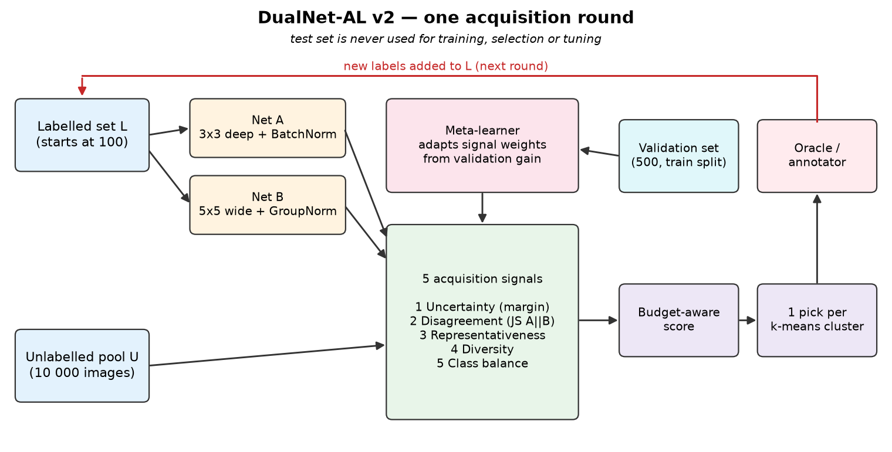
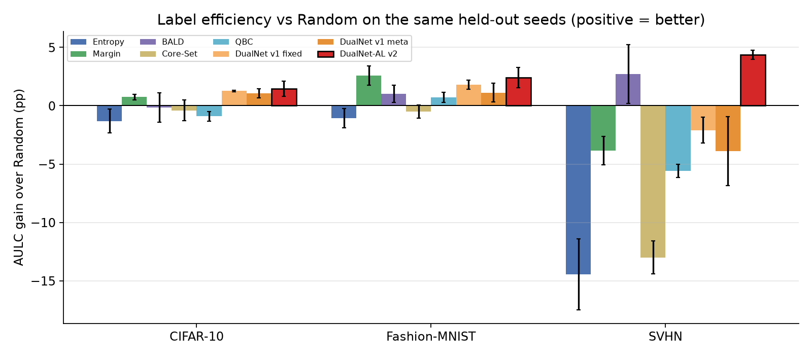
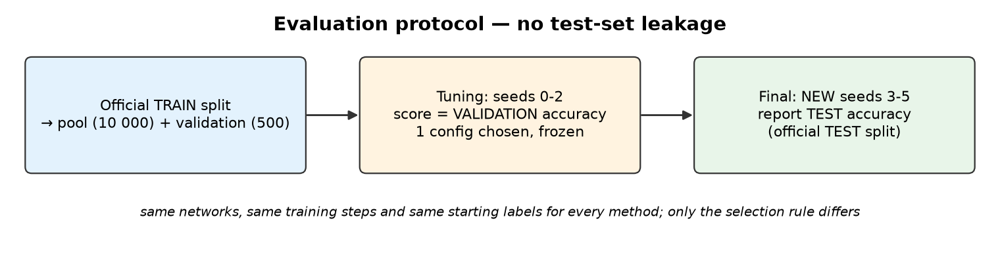

# DualNet-AL

**A Bi-Network Meta-Learning Framework for Multi-Class Active Learning**

Capstone project BT-20 · IILM University, Greater Noida · B.Tech CSE (4th year), 2026–27
Himansh Raj (CS-23411324) · Om Narayan Pandey (CS-2341893) · Guide: Dr. Jaswinder Singh

📄 **Paper:** [deliverables/DualNet-AL_Paper.pdf](deliverables/DualNet-AL_Paper.pdf) — Himansh Raj, Om Narayan Pandey,
Jaswinder Singh, *“DualNet-AL: A Bi-Network Meta-Learning Framework for Multi-Class Active Learning”*, IILM University,
2026 (5 pages; generated from the results in this repository by `dualnet_al/build_paper.py`).
🎞️ **Video:** [deliverables/DualNet-AL_Motion.mp4](deliverables/DualNet-AL_Motion.mp4) ·
📊 **Slides:** [deliverables/DualNet-AL_Midterm.pptx](deliverables/DualNet-AL_Midterm.pptx)

Active learning trains a classifier with as few human labels as possible by letting the model choose which
unlabelled images to label next. DualNet-AL trains **two different networks**, scores every unlabelled image with
**five signals**, combines them with **weights a meta-learner adapts every round**, and builds each batch so it
covers the whole data distribution with no near-duplicates.



## Results (held-out, leak-free)

Area under the accuracy-vs-labels curve (AULC, %; higher = more accuracy per label), mean ± std over three new
seeds (3, 4, 5) that were never used for tuning. 100 → 900 labels in 8 rounds of 100; 2 000-image test set per
dataset. Every method uses the same two networks, the same training steps and the same starting labels; only
the selection rule differs. Best per dataset in bold.

| Method | Fashion-MNIST | SVHN | CIFAR-10 |
|---|---|---|---|
| Random | 78.92 ± 1.18 | 53.17 ± 1.49 | 47.20 ± 0.30 |
| Entropy | 77.86 ± 0.88 | 38.71 ± 1.57 | 45.88 ± 1.01 |
| Margin | **81.49 ± 0.38** | 49.34 ± 2.70 | 47.95 ± 0.21 |
| BALD (MC-Dropout) | 79.94 ± 0.48 | 55.89 ± 1.25 | 47.05 ± 1.19 |
| Core-Set (k-Center) | 78.42 ± 0.66 | 40.18 ± 1.65 | 46.81 ± 1.17 |
| QBC (A/B disagreement) | 79.63 ± 0.81 | 47.58 ± 1.77 | 46.30 ± 0.64 |
| DualNet-AL v1 (fixed weights) | 80.72 ± 0.82 | 51.08 ± 1.56 | 48.46 ± 0.34 |
| DualNet-AL v1 (meta-learned) | 80.04 ± 0.67 | 49.30 ± 4.34 | 48.26 ± 0.68 |
| **DualNet-AL v2** | 81.33 ± 0.34 | **57.56 ± 1.12** | **48.66 ± 0.52** |

DualNet-AL v2 compared with Random on the same seeds:

| Dataset | AULC gain | Seeds better | Final accuracy | Worst-class recall | Macro-F1 |
|---|---|---|---|---|---|
| Fashion-MNIST | +2.41 pp | 3/3 | 83.65 vs 81.02 | 46.8 vs 38.0 | 83.51 vs 80.72 |
| SVHN | +4.38 pp | 3/3 | 69.70 vs 70.20 | 40.5 vs 16.7 | 65.77 vs 63.91 |
| CIFAR-10 | +1.46 pp | 3/3 | 53.98 vs 52.93 | 27.9 vs 21.2 | 53.07 vs 51.70 |

Honest reading: v2 is the best method on SVHN and CIFAR-10 and second on Fashion-MNIST (Margin is 0.17 pp ahead).
On SVHN its *final* accuracy is 0.5 pp below Random even though its area under the curve is 4.4 pp higher, i.e. it
is more accurate at almost every earlier budget. Three seeds give a paired comparison, not yet a significance test.



## Evaluation protocol (no test-set leakage)



1. Pool (10 000) and validation (500) images come only from the official **train** split; the 2 000 test images
   come only from the official **test** split. Standardisation uses pool statistics only.
2. **Tuning** (`tune.py`): 6 candidate v2 settings + 2 references, seeds 0–2, scored on **validation** accuracy.
   The test set is never evaluated in this mode (`run_al(..., eval_test=False)`, covered by a unit test).
   One setting is chosen for all datasets and frozen in `results/tuning/chosen_config.json`
   (chosen: `c3_half_ramp4_margin` — start half typical / half learned score, hand over fully by round 4,
   margin uncertainty).
3. **Final comparison** (`run_experiments.py`): all 9 methods on new seeds 3–5, reporting test accuracy.

## How it works

| Part | What it does |
|---|---|
| Net A | 6-conv 3×3 CNN with BatchNorm (289k params) |
| Net B | wide 5×5 CNN with GroupNorm and an MLP head (170k params) — different design, different mistakes |
| Uncertainty | margin between the two most likely classes of the A+B average |
| Disagreement | Jensen-Shannon divergence between A and B + argmax mismatch |
| Representativeness | mean cosine similarity to the 10 nearest pool neighbours (avoids outliers) |
| Diversity | distance to the nearest already-labelled image |
| Class balance | rarity of the predicted class in the labelled set |
| Meta-learner | re-weights the 5 signals each round from the validation-accuracy gain and from which signals pointed at real mistakes once labels arrived; every weight stays ≥ 5 % |
| v2 budget-aware score | `(1−λ)·representativeness + λ·(meta-weighted score)`, λ ramps from 0.5 to 1 over 4 rounds: with very few labels the model's own uncertainty is unreliable, so typical images come first |
| v2 batch | GPU k-means into B = 100 clusters, best-scoring image from each cluster |

## Run the demo

**Windows:** double-click `dualnet_al/run_demo.bat`.
**Linux / macOS:** `./dualnet_al/run_demo.sh`

The first run installs [uv](https://github.com/astral-sh/uv), Python 3.12, PyTorch (CUDA build if an NVIDIA GPU is
found, otherwise CPU) and the packages into `dualnet_al/.venv`, then opens the live demo at
<http://localhost:8501>. In the app, pick a dataset and a strategy and press **Run active learning**: it trains
both networks round by round and shows accuracy, the signal weights, the images it chose and a side-by-side run of
Random on the same seed. The **Benchmark results** tab shows the held-out table above.

`./dualnet_al/run_demo.sh --check` installs and runs the test suite without starting the server.

## Reproduce everything

```bash
cd dualnet_al
./run_demo.sh --check                                   # environment + 30 tests
.venv/bin/python tune.py --shard 0/1                    # 72 tuning runs (validation only)
.venv/bin/python tune.py --choose                       # writes results/tuning/chosen_config.json
.venv/bin/python run_experiments.py --out results_heldout --seeds 3 4 5 \
    --strategies random entropy margin bald coreset qbc dualnet_fixed dualnet_meta --val 500
.venv/bin/python run_experiments.py --out results_heldout --seeds 3 4 5 --strategies dualnet_v2 \
    --v2cfg results/tuning/chosen_config.json --val 500
.venv/bin/python run_experiments.py --out results_heldout --summarize-only
.venv/bin/python make_figures.py && .venv/bin/python build_pptx.py
```

`finalize.sh` runs the whole chain in one go under a resource cap. Each run is saved as one JSON file, so an
interrupted grid resumes where it stopped. Measured on an RTX 5060 Ti: about 25–60 s per run.

CIFAR-10 and SVHN are loaded from the Hugging Face mirrors of the official splits (`uoft-cs/cifar10`,
`ufldl-stanford/svhn`) when the original hosts are unreachable; Fashion-MNIST comes from torchvision.

## Repository layout

```
dualnet_al/
  dualnet/            data, models, training, signals, meta-learner, batch selection, active-learning loop
  tests/              30 pytest tests (signals, selection, meta-learner, no-relabelling, test-set isolation, GPU)
  app.py              Streamlit live demo
  tune.py             validation-only tuning of v2
  run_experiments.py  benchmark grid + aggregation (paired comparison vs Random)
  make_figures.py     charts and diagrams
  build_paper.py      research paper (HTML -> PDF) from the results
  build_pptx.py       presentation deck from the results;  check_pptx.py  slide layout check
  video/              Kokoro-voiced, Whisper-checked motion-graphics video (manim)
  results/            tuning runs, chosen config, demo screenshots
  results_heldout/    held-out runs (81 JSON files), summary.json, plots
  run_demo.bat/.ps1/.sh   one-command launchers
deliverables/
  DualNet-AL_Paper.pdf        research paper (5 pages, 3 authors)
  DualNet-AL_Midterm.pptx     mid-term presentation (15 slides)
  DualNet-AL_Motion.mp4       narrated video
  Video_Narration_Script.txt
```

## Limitations and next steps

- Low label budget (≤ 900) and 10 000-image pools; gaps between methods are a few points.
- Three held-out seeds: paired comparison only; Wilcoxon tests over more seeds are planned.
- The meta-learner's reward uses a 500-image validation set that other methods do not use; a label-free reward is
  planned.
- Calibration (expected calibration error) is worse than Random; temperature scaling is the planned fix.
- Next: CIFAR-100 and long-tail data, the BADGE and Learning-Loss baselines, larger budgets on the full datasets,
  ResNet backbones, and submission of the paper to a SCOPUS-indexed conference.

## Citation

```bibtex
@techreport{raj2026dualnetal,
  title       = {DualNet-AL: A Bi-Network Meta-Learning Framework for Multi-Class Active Learning},
  author      = {Raj, Himansh and Pandey, Om Narayan and Singh, Jaswinder},
  institution = {School of Computer Science and Engineering, IILM University, Greater Noida},
  year        = {2026},
  url         = {https://github.com/iamthehimansh/DualNet-AL_Motion}
}
```
